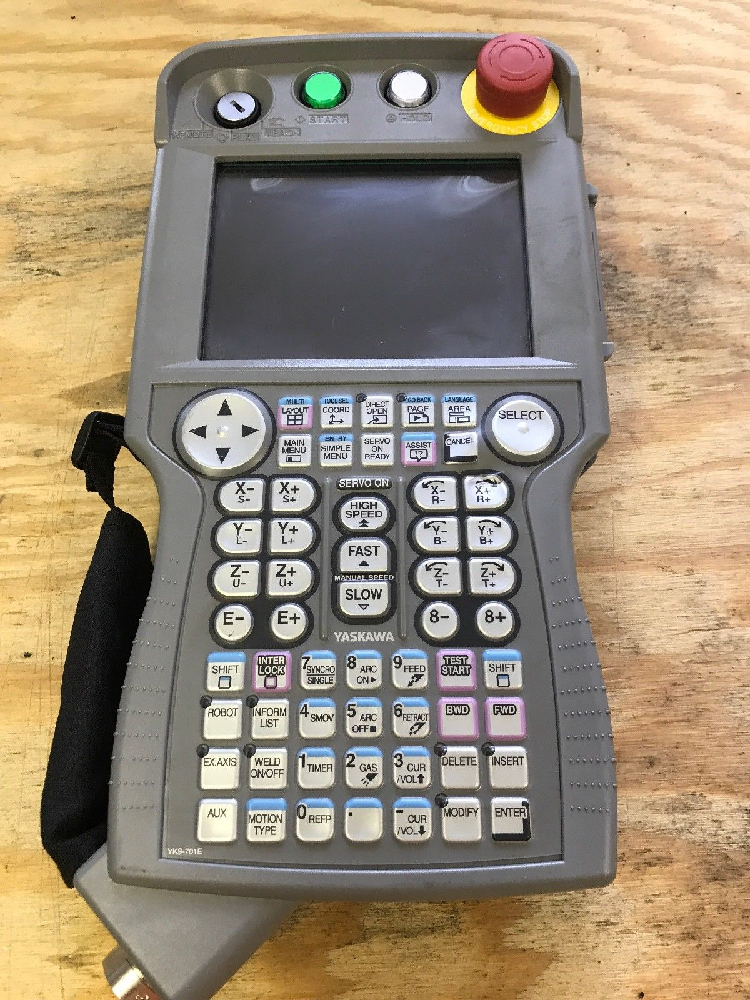

### Comparacion de robots

| Característica | Motoman MH6 | ABB IRB140 |
| ------------- | ------------- | ------------- |
| Fabricante | Yaskawa | ABB |
| Tipo de robot | Articulado | Articulado |
| Número de ejes | 8* | 6 |
| Carga máxima | 10 kg | 6 kg |
| Alcance horizontal | 1422 mm | 810 mm |
| Repetibilidad | ±0,08 mm | ±0,03 mm |
| Masa | 130 kg | 98 kg |

En lo que respecta a aplicaciones ambos robots trabajan en ámbitos similares, siendo estos aplicaciones industriales que requieren flexibilidad de alcance y herramientas, posiciones de entradas variables y cargas pequeñas o moderadas. Una diferencia particular es la forma en la que ambos robots han sido modificados durante su tiempo en la universidad, particularmente que el Motoman ha sido modificado con otros añadidos durante su tiempo en la sala CAM, el septimo grado de libertad que tiene es para un manipulador lateral y el octavo controla un mecanismo para desplazar el manipulador entero.
### Posiciones de Home

Home 1 y Home 2 son las 2 posiciones de descaso que tiene el Robot, ambas orientadas que el manipulador regrese a ellas y que pase la mayor parte de su tiempo así. La diferencia esta en la escala de operación: Home 2 es la posición que tima el manipulador cuando esta en operación pero no esta tomando alguna accion en particular, es una posición a desde la que las articulaciones deben ejercer comparativamente poco tiempo y energía para llegar a los que les pidan las rutinas creadas por el usuario, al menos en posiciones que no sean extremadamente exoticas, es en efecto un punto coun al que el manipulador puede volver.

  
  

Por otro lado el punto Home 1 es la posición de descanso del manipulador, en este punto el gasto de energía para mantener posición es efectivamente nulo, lo que permite que los frenos experimenten un desgaste mucho menos, demás el volumen conjunto del robot también es menor, lo que facilita el transporte en conjunto. Esta es la posición es mejor para cuando el robot esta apagado por una razón u otra.

Dada esta informacion la mejor posicion para la operacion del manipulador es Home 2, con el entendimiento de que se llegara a Home 1 antes de que se apague el Robot.

### Movimientos Manuales del Robot

Los movimientos manuales del Robot son realizados via su teach pendant (aclaracion, el teach pendant de la imagen es el mismo modelo del que esta en la sala CAM pero no es exactamente ese).

  

### a
### a
### a
### a
### a
### a
### Video de simulación y prueba
Link del video de demostracion: https://www.youtube.com/watch?v=zOlbh4mJVK8
